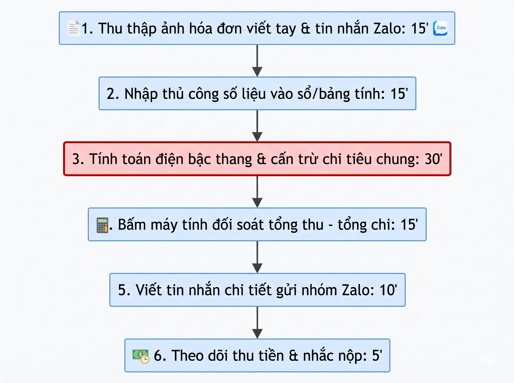
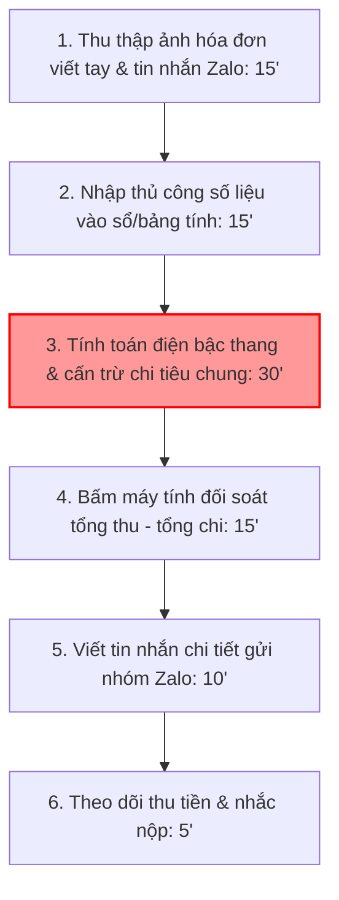
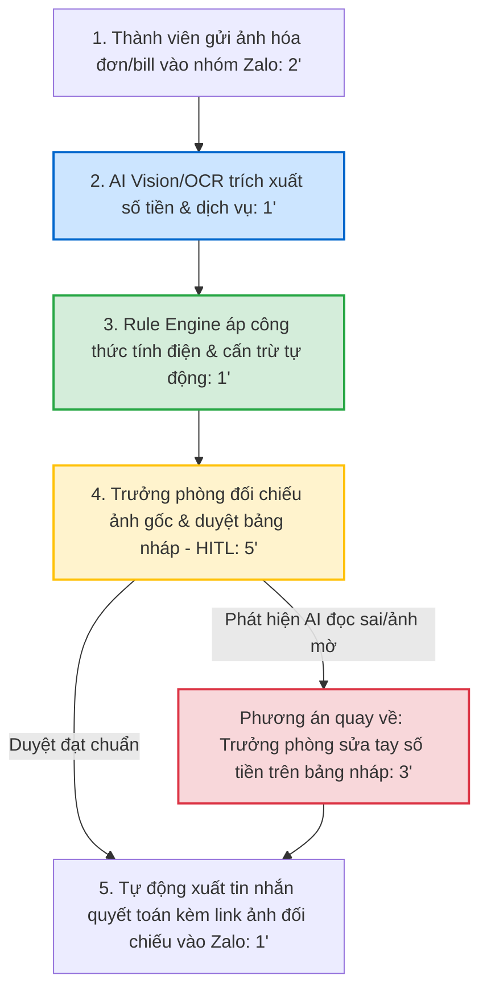
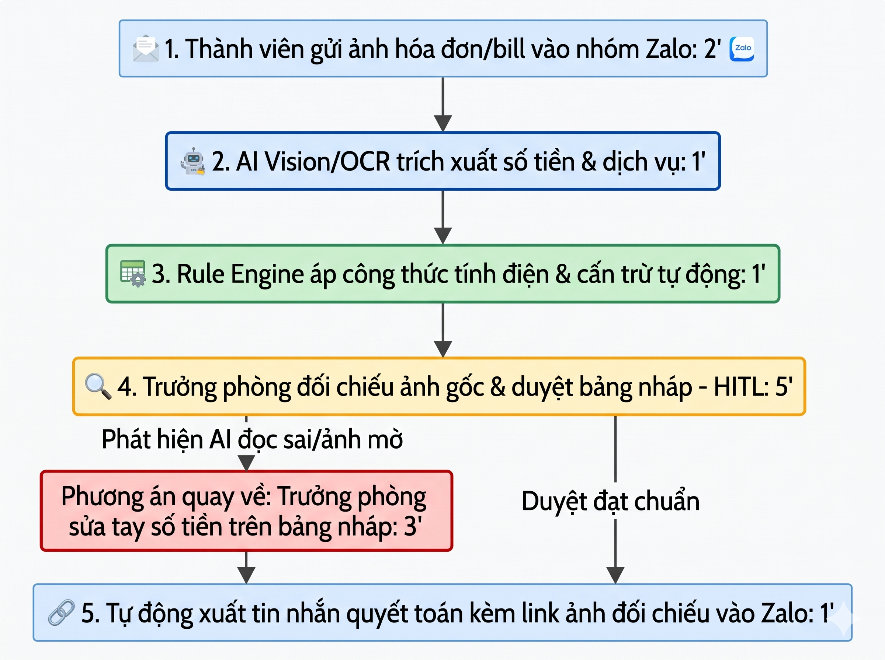

# Báo cáo nhóm — Day 02 Discovery & Problem Framing

> Bản chung của nhóm, viết trên repo do nhóm trưởng fork. Không copy file này sang repo cá nhân.
> Template chi tiết và prompt mẫu: [docs/01-worksheet.md](../../docs/01-worksheet.md). Bài mẫu: [docs/02-deliverable-example.md](../../docs/02-deliverable-example.md).

## 1. Thông tin nhóm

- Tên nhóm: Nhom11 (Lớp K5 · L3B)
- Thành viên: xem `TEAM.md` (Nguyễn Duy Hưng, Nguyễn Văn Lâm, Đặng Nguyễn Nhật Minh)
- Candidate problem được chọn (1 câu): Tính toán và phân bổ chi phí sinh hoạt phòng trọ hàng tháng từ ảnh chụp hóa đơn dịch vụ và tin nhắn chi tiêu chung.
- Quyết định cuối: Go (Pilot phạm vi nhỏ)

---

## 2. Hội tụ nhóm (CP3)

### 2.1. Pitch

| # | Người đưa ra | Candidate (Job Story ngắn) | Actor | Bottleneck | Câu hỏi phản biện nhận được (ai hỏi) |
|---:|---|---|---|---|---|
| 1 | Nguyễn Duy Hưng | Khi sắp đến hạn nộp bài lab môn học trên LMS, tôi muốn đối chiếu nhanh toàn bộ file và cấu trúc repo với checklist, để nộp đúng quy cách và không bị trừ điểm. | Sinh viên / Trưởng nhóm nộp bài lab | Mở rà soát thủ công từng file cá nhân & nhóm xem có sót template rỗng và sai cú pháp tên (20') | "Tại sao không viết một shell script hoặc dùng Regex kiểm tra cấu trúc thư mục và tên file là xong, phần nào thực sự cần AI?" (Lâm hỏi) |
| 2 | Nguyễn Duy Hưng | Khi vừa kết thúc buổi họp nhóm kéo dài hơn 1 tiếng, tôi muốn tổng hợp nhanh danh sách việc cần làm (action items), người phụ trách và deadline từ bản ghi chép thô, để gửi các thành viên xác nhận. | Thư ký cuộc họp nhóm | Nghe lại đoạn tranh luận trong file ghi âm để xác nhận kết luận chốt ai nhận task (20') | "Chất lượng âm thanh phòng họp nhiều tạp âm và tiếng nói chèn nhau, transcript có đủ chuẩn tiếng Việt để AI bóc tách chính xác không?" (Minh hỏi) |
| 3 | Nguyễn Duy Hưng | Khi integration test bị lỗi với hàng trăm dòng log và stack trace dài, tôi muốn xác định nhanh nguyên nhân gốc rễ và module gây lỗi, để sửa đúng chỗ mà không phải đọc tuần tự từng dòng log. | Lập trình viên / Tester | Đọc stack trace lồng nhau qua hàng chục tầng thư viện để định vị dòng code của mình gây lỗi (20') | "Stack trace phụ thuộc rất nhiều vào ngôn ngữ và framework, nhóm có đủ dữ liệu mẫu để AI phân tích chuẩn xác trong khuôn khổ lab không?" (Lâm hỏi) |
| 4 | Nguyễn Văn Lâm | Khi nhận hóa đơn sinh hoạt và tiền mua đồ chung vào ngày 28 hàng tháng, tôi muốn tính toán phân bổ chính xác số tiền mỗi người phải đóng theo dịch vụ sử dụng, để công khai minh bạch cho cả phòng trong 30 phút. | Trưởng phòng trọ / Người quản lý chi tiêu chung | Phân bổ và cấn trừ các khoản chi mua đồ chung lắt nhắt, người về quê được giảm trừ tiền nước (30') | "Hóa đơn điện nước chủ trọ thường viết tay nguệch ngoạc hoặc chụp mờ, OCR/Vision có đọc chuẩn được số không hay vẫn phải nhập tay?" (Hưng hỏi) |
| 5 | Nguyễn Văn Lâm | Khi chuẩn bị đi siêu thị vào chiều Chủ Nhật, tôi muốn biết chính xác trong tủ lạnh còn những thực phẩm nào và gợi ý món ăn 5 ngày tới, để mua đúng nguyên liệu mà không bị mua thừa hay để đồ hỏng. | Người nấu ăn chính trong phòng trọ | Suy nghĩ món ăn kết hợp từ các nguyên liệu lẻ tẻ còn sót trong tủ lạnh để không bị ngán và hỏng đồ (25') | "Sở thích ăn uống của các bạn cùng phòng thay đổi thất thường, liệu gợi ý thực đơn có thực tế được nấu hay cuối cùng vẫn rủ nhau ra ngoài ăn?" (Minh hỏi) |
| 6 | Nguyễn Văn Lâm | Khi cần tìm phòng trọ mới trước khi hết hạn hợp đồng 1 tháng, tôi muốn lọc ra các phòng trọ thỏa mãn tiêu chí từ hàng trăm bài đăng rao vặt trên Facebook/Chợ Tốt, để chọn 3–5 phòng uy tín đến xem trực tiếp. | Sinh viên / Người chuẩn bị đổi trọ | Nhắn tin hỏi các chi phí ẩn và soi trang cá nhân để lọc tin môi giới ảo (50') | "Dữ liệu bài đăng trên Facebook rất phân mảnh và trôi liên tục, làm sao nhóm thu thập được nguồn dữ liệu bài đăng sạch để đưa vào hệ thống?" (Hưng hỏi) |
| 7 | Đặng Nguyễn Nhật Minh | Khi cần viết PRD cho tính năng mới, tôi muốn nhanh chóng tổng hợp tất cả ý kiến từ nhiều nguồn, để viết specs chuẩn xác mà không bỏ sót insight. | Product Manager | Đọc, hiểu bối cảnh và lọc bỏ các feedback trùng lặp hoặc nhiễu từ nhiều kênh (120') | "Nhóm lấy đâu ra tập feedback khách hàng thực tế và làm sao đo lường được chất lượng bản PRD viết ra đã đạt hay chưa trong thời gian ngắn?" (Lâm hỏi) |
| 8 | Đặng Nguyễn Nhật Minh | Khi đội lập trình bắt tay vào code, tôi muốn họ hiểu đúng 100% specs mà không hỏi lại những chi tiết đã có trong tài liệu, để tôi không bị ngắt quãng công việc. | Product Manager và Đội Devs | PM bị ngắt việc, mở lại Doc/Figma để tìm chính xác dòng quy định logic đó (10'/lần, nhiều lần/ngày) | "AI có hiểu được các logic đan chéo phức tạp trong file PRD dài không, và Dev có chịu thay đổi thói quen chat trực tiếp với PM sang hỏi bot không?" (Hưng hỏi) |
| 9 | Đặng Nguyễn Nhật Minh | Khi cần nghiên cứu đối thủ định kỳ, tôi muốn có báo cáo tóm tắt nhanh tính năng mới của họ, để điều chỉnh lộ trình sản phẩm mà không phải tự tải app trải nghiệm tay. | Product Manager | Tự tải app, đăng nhập, trải nghiệm, cap màn hình và ghi chép thay đổi (200' cho 5 app) | "Làm sao vượt qua được cơ chế chặn bot của các app store và website đối thủ, và làm sao kiểm chứng được với người thật tại lớp?" (Lâm hỏi) |

### 2.2. Cluster

| Cluster | Các candidate | Pattern chung |
|---|---|---|
| A — Báo cáo & Tổng hợp dữ liệu (Aggregation & Synthesis) | #2 (Biên bản họp), #7 (Tổng hợp feedback PRD), #9 (Phân tích đối thủ) | Thu thập văn bản/thông tin phi cấu trúc từ nhiều kênh rời rạc (lời nói, tin nhắn khách hàng, app đối thủ) để tổng hợp thành tài liệu báo cáo cho người khác đọc. |
| B — Phân bổ tài nguyên & Quản lý sinh hoạt (Resource & Financial Allocation) | #4 (Phân bổ chi phí trọ), #5 (Thực đơn tủ lạnh), #6 (Sàng lọc phòng trọ) | Thu thập dữ liệu đời sống thực tế (hóa đơn sinh hoạt, thực phẩm còn lại, bài đăng mạng xã hội) để tính toán phân bổ công bằng hoặc ra quyết định sinh hoạt tối ưu. |
| C — Kiểm tra, Tra cứu & Hỗ trợ vận hành (Validation & Knowledge Retrieval) | #1 (Checklist nộp lab), #3 (Phân tích log test), #8 (Bot giải đáp specs cho Dev) | Tiếp nhận đầu vào kỹ thuật phức tạp (file bài nộp, stack trace, câu hỏi kỹ thuật), đối chiếu với bộ quy chuẩn hoặc tài liệu để phát hiện sai lệch hoặc giải đáp nhanh. |

### 2.3. Opportunity Solution Tree rút gọn

Gốc là **1 outcome**. Nhánh là **opportunity** (nhu cầu, pain), không phải tính năng hay công cụ.

```text
OUTCOME: Giảm thời gian và loại bỏ sai sót khi quản lý, quyết toán các chi phí sinh hoạt chung định kỳ trong phòng trọ sinh viên
├── Opportunity A: Thu thập dữ liệu thủ công từ nhiều nguồn phi cấu trúc (ảnh hóa đơn viết tay của chủ trọ, tin nhắn mua đồ lẻ tẻ trên Zalo) tốn nhiều thời gian nhập liệu lại
├── Opportunity B: Việc tính toán phân bổ phức tạp và cấn trừ các khoản chi tiêu lắt nhắt dễ nhầm lẫn, gây nghi ngờ và mất lòng nhau trong phòng
└── Opportunity C: Khó khăn trong việc đối chiếu, soát lỗi và đảm bảo tính minh bạch trước khi công bố bảng quyết toán cho tập thể
```

Những ý đã gạch bỏ vì là solution đội lốt opportunity:

- ✗ *"Ứng dụng tự động trừ tiền trong tài khoản ngân hàng của từng thành viên"* $\rightarrow$ Solution đội lốt (đây là tính năng thanh toán, không phải nhu cầu cốt lõi).
- ✗ *"Chatbot AI siêu quản gia tự động nhắn tin đòi nợ vào Zalo"* $\rightarrow$ Solution trá hình (đây là tính năng AI, không phản ánh nỗi đau phân bổ chi phí).
- ✗ *"Dashboard tích hợp toàn bộ hóa đơn điện tử thông minh"* $\rightarrow$ Solution đội lốt (không phản ánh thực tế phần lớn hóa đơn nhà trọ sinh viên là giấy viết tay hoặc ảnh chụp công tơ).

### 2.4. Chấm điểm shortlist (1–5)

| Candidate | Actor rõ | Quy trình rõ | Pain có bằng chứng | Impact đo được | Vừa sức lab | So sánh được No AI/Rule/Workflow/Agent | Nhóm hiểu domain | Tổng |
|---|---:|---:|---:|---:|---:|---:|---:|---:|
| **Candidate 1: Tính toán & phân bổ chi phí sinh hoạt phòng trọ (#4)** | 5 | 5 | 5 | 5 | 5 | 5 | 5 | **35** |
| Candidate 2: Rà soát checklist & cấu trúc nộp bài lab môn học (#1) | 5 | 5 | 4 | 4 | 5 | 3 | 5 | **31** |
| Candidate 3: Tổng hợp feedback khách hàng để viết PRD (#7) | 4 | 4 | 3 | 4 | 2 | 4 | 3 | **24** |

**Candidate được chọn:**
**Candidate #4 — Tính toán và phân bổ chi phí sinh hoạt phòng trọ hàng tháng (Nguyễn Văn Lâm)**.

**Vì sao chọn:**
1. Đạt điểm số tuyệt đối (**35/35**) trên toàn bộ 7 tiêu chí đánh giá của nhóm.
2. **Actor & Quy trình cực kỳ chuẩn mực:** Trưởng phòng trọ quản lý chi tiêu chung phòng 3–4 người, quy trình diễn ra định kỳ vào ngày 28 hàng tháng, có các bước thu thập, nhập liệu, tính toán cấn trừ và đối soát rất rõ ràng.
3. **Bottleneck cụ thể và có baseline đo lường được:** Bước tính toán cấn trừ các khoản chi tiêu lẻ và giảm trừ tiền nước người về quê tốn 30 phút; tổng quy trình tốn 90 phút/tháng; có bằng chứng tính nhầm dẫn đến tranh cãi.
4. **Tính khả thi kiểm chứng vượt trội (Feasibility):** Cả 3 thành viên trong nhóm đều đang ở trọ hoặc có bạn bè cùng lớp ở trọ; nhóm có thể tiếp cận và phỏng vấn ngay người thật theo chuẩn *The Mom Test* tại lớp mà không cần phải bịa đặt dữ liệu hay xin quyền truy cập nội bộ công ty.
5. **So sánh rõ ràng giữa 4 mức giải pháp:** Rất dễ phân định giữa No AI (Google Sheets), Rule (công thức tính tự động) và Workflow AI (Vision/OCR trích xuất số liệu hóa đơn viết tay + Rule tính toán + Human-in-the-loop duyệt).

**Vì sao loại các candidate còn lại:**
- *Loại Candidate 2 (Rà soát nộp bài lab):* Quy trình quá thiên về Rule-based/Script (chỉ cần viết Bash/Python script chạy Regex kiểm tra tên file và đếm dòng là giải quyết được 80% vấn đề); nếu cố đưa AI vào chỉ là dùng AI cho có, khó chứng minh tính cần thiết của AI và thiếu không gian xây dựng quy trình Human-in-the-loop phong phú.
- *Loại Candidate 3 (Tổng hợp feedback khách hàng):* Đề tài hay nhưng nhóm không có sẵn sản phẩm chạy thực tế với tập feedback khách hàng thật; rất khó tiếp cận người thật tại lớp để phỏng vấn theo The Mom Test trong vòng 30 phút; dữ liệu khách hàng và PRD doanh nghiệp mang tính nội bộ.

**Xử lý bất đồng (nếu có):**
Ban đầu Đặng Nguyễn Nhật Minh muốn chọn bài toán Tổng hợp feedback khách hàng để viết PRD vì muốn giải quyết một bài toán PM kinh điển và phát huy thế mạnh LLM xử lý văn bản phi cấu trúc. Tuy nhiên, Nguyễn Duy Hưng và Nguyễn Văn Lâm đã chỉ ra rủi ro nghiêm trọng ở CP4: Rubric C7 trừ điểm rất nặng nếu câu hỏi phỏng vấn mang tính giả định hoặc bịa đặt kết quả; việc đang ngồi tại lớp học khiến nhóm không thể tiếp cận người thật là khách hàng/PM doanh nghiệp để hỏi về hành vi đã xảy ra. Sau khi cùng chấm điểm theo 7 tiêu chí, Minh đã hoàn toàn đồng thuận rằng bài toán Chi phí phòng trọ vừa sức hơn, bằng chứng thực tế hơn và hoàn toàn có thể triển khai xuất sắc từ CP3 đến CP6.

---

## 3. Kiểm chứng + research giải pháp đã có (CP4)

### 3.1. Assumption Map

| # | Giả định | Loại (Value / Usability / Feasibility / Viability) | Quan trọng (1–5) | Đã có bằng chứng (1–5) | Kiểm chứng trước? |
|---:|---|---|---:|---:|---|
| 1 | Trưởng phòng trọ mất từ 60–90 phút mỗi tháng để thu thập hóa đơn và tính tiền cho cả phòng. | Value | 5 | 3 | Có |
| 2 | Nút thắt gây tốn thời gian và dễ tranh cãi nhất là việc cấn trừ các khoản chi tiêu lắt nhắt và giảm trừ tiền nước người về quê, không phải việc chia tiền phòng cố định. | Value | 5 | 2 | ✅ Kiểm chứng trước |
| 3 | Các thành viên cùng phòng chuộng gửi ảnh chụp hóa đơn/biên lai lên nhóm chat hơn là tự mở bảng tính Google Sheets để nhập số liệu. | Usability / Value | 4 | 2 | ✅ Kiểm chứng trước |
| 4 | Công nghệ Vision/OCR hiện nay có thể trích xuất chính xác số tiền và chỉ số từ hóa đơn viết tay của chủ trọ và ảnh chụp màn hình chuyển khoản. | Feasibility | 5 | 2 | ✅ Kiểm chứng trước |
| 5 | Các thành viên sẵn sàng chấp nhận kết quả quyết toán do hệ thống tự tính nếu có đính kèm ảnh gốc để đối soát và trưởng phòng đã duyệt. | Viability / Usability | 4 | 2 | ✅ Kiểm chứng trước |

Giả định nhóm kiểm chứng trong buổi này: **Giả định #2, #3 và #5** thông qua phỏng vấn sâu người thật theo nguyên tắc *The Mom Test* và một micro-survey nhanh.

### 3.2. Kiểm chứng

Cách đã dùng: **Phỏng vấn trực tiếp theo The Mom Test** (5 phỏng vấn sâu) kết hợp **Micro Survey** (22 sinh viên đang ở trọ).

#### Các Interview Snapshots (5 người thật)

**Interview Snapshot #1:**

| Trường | Nội dung |
|---|---|
| Người được hỏi (vai trò, không ghi tên thật) | Trưởng phòng trọ (sinh viên năm 3, ở ghép 4 người tại Cầu Giấy, Hà Nội) |
| Câu nói đáng nhớ nhất (nguyên văn) | *"Tiền phòng với tiền mạng thì chia cái roẹt là xong, cái bực nhất là tiền điện tính bậc thang rồi ông này đi thực tập 2 tuần đòi trừ tiền nước, ông kia ứng tiền mua nước giặt 120k đòi cấn trừ lại."* |
| Lần gần nhất gặp vấn đề này: chuyện gì đã xảy ra? | Tối ngày 30/10 vừa qua, ngồi bấm máy tính Casio và lội tin nhắn Zalo mất hơn 80 phút; tính nhầm số tiền giảm trừ khiến 1 bạn bị thu thừa 35.000đ, hôm sau phải chuyển khoản trả lại rất mất công. |
| Hiện đang xử lý bằng cách nào (workaround)? | Ghi các khoản chi ra sổ tay, cuối tháng mở máy tính cầm tay bấm từng phép tính rồi gõ tin nhắn dài vào Zalo. |
| Mất bao lâu, bao lần? | 1 lần/tháng vào ngày 30, mất trung bình 75–90 phút. |
| Insight / opportunity rút ra | Pain point thực sự không nằm ở phép chia đều tiền nhà, mà nằm ở việc tính toán các quy tắc phát sinh không đồng đều (về quê, mua sắm đồ dùng chung). |

**Interview Snapshot #2:**

| Trường | Nội dung |
|---|---|
| Người được hỏi (vai trò, không ghi tên thật) | Người giữ quỹ phòng trọ (sinh viên năm 2, phòng 3 nữ tại Hai Bà Trưng, Hà Nội) |
| Câu nói đáng nhớ nhất (nguyên văn) | *"Bọn mình từng lập file Google Sheets rồi nhưng chẳng ai chịu mở ra điền, cuối cùng vẫn cứ chụp bill vứt vào nhóm Zalo rồi réo mình tổng hợp."* |
| Lần gần nhất gặp vấn đề này: chuyện gì đã xảy ra? | Đợt thi giữa kỳ tháng trước, bận ôn thi nên quên không tính tiền, đến ngày mùng 4 chủ nhà nhắn tin giục gắt gao trong nhóm, cả phòng cuống cuồng ngồi gom bill chia vội. |
| Hiện đang xử lý bằng cách nào (workaround)? | Ai mua gì thì chụp ảnh hóa đơn gửi vào nhóm Zalo và tag tên người giữ quỹ để ghim tin nhắn. |
| Mất bao lâu, bao lần? | Mua đồ lẻ tẻ 2–3 lần/tuần; cuối tháng ngồi tổng hợp mất khoảng 60 phút. |
| Insight / opportunity rút ra | Người dùng có thói quen gửi ảnh/tin nhắn vào ứng dụng chat sẵn có; bắt họ đổi hành vi sang nhập liệu form/sheet là thất bại về mặt Usability. |

**Interview Snapshot #3:**

| Trường | Nội dung |
|---|---|
| Người được hỏi (vai trò, không ghi tên thật) | Thành viên phòng trọ — người đóng tiền (sinh viên năm 4, phòng 3 người tại Đống Đa) |
| Câu nói đáng nhớ nhất (nguyên văn) | *"Nhiều khi bạn trưởng phòng gửi tin nhắn chia tiền dài dằng dặc, mình nhìn chả hiểu tính thế nào nhưng ngại hỏi lại vì sợ mang tiếng săm soi từng đồng với bạn bè."* |
| Lần gần nhất gặp vấn đề này: chuyện gì đã xảy ra? | Tháng 9 vừa rồi thấy tiền điện tăng vọt gấp rưỡi nhưng không có ảnh chụp chỉ số công tơ kèm theo, mãi sau mới biết là do điều hòa chạy qua đêm mùa nóng. |
| Hiện đang xử lý bằng cách nào (workaround)? | Chuyển khoản luôn theo số tiền được báo mà không kiểm tra lại, dù thỉnh thoảng vẫn thấy lấn cấn. |
| Mất bao lâu, bao lần? | Diễn ra đều đặn mỗi tháng một lần. |
| Insight / opportunity rút ra | Tính minh bạch và việc đính kèm bằng chứng ảnh gốc có giá trị tâm lý rất lớn, giúp loại bỏ sự nghi ngờ ngầm giữa những người ở chung. |

**Interview Snapshot #4:**

| Trường | Nội dung |
|---|---|
| Người được hỏi (vai trò, không ghi tên thật) | Người đại diện thu tiền tầng (sinh viên năm cuối, phụ trách thu hộ 4 phòng trọ chung tầng tại Thanh Xuân) |
| Câu nói đáng nhớ nhất (nguyên văn) | *"Chủ nhà đưa tờ giấy viết tay tổng tiền cả tầng, chữ số 1 với số 7 ngoáy như nhau, nhìn nhầm một phát là cuối tháng mình phải tự bỏ tiền túi ra bù."* |
| Lần gần nhất gặp vấn đề này: chuyện gì đã xảy ra? | Đợt tháng 8 nhìn nhầm chỉ số nước viết tay số 4 thành số 1, suýt nữa phải bù 250.000đ tiền nước nếu không chụp ảnh công tơ đối chiếu lại. |
| Hiện đang xử lý bằng cách nào (workaround)? | Lấy bút dạ quang tô lại các con số quan trọng trên giấy rồi mới tính. |
| Mất bao lâu, bao lần? | 1 lần/tháng, mất khoảng 90–120 phút cho cả tầng. |
| Insight / opportunity rút ra | Nhận diện chữ viết tay từ hóa đơn chủ nhà là bước có rủi ro sai sót cao nhất; bắt buộc phải có bước con người đối soát (Human-in-the-loop) trước khi công bố. |

**Interview Snapshot #5:**

| Trường | Nội dung |
|---|---|
| Người được hỏi (vai trò, không ghi tên thật) | Cựu sinh viên mới ra trường đi làm (ở ghép 2 người tại Hoàng Mai, Hà Nội) |
| Câu nói đáng nhớ nhất (nguyên văn) | *"Bọn mình từng tải Splitwise về dùng thử được 2 tuần rồi xóa, vì nó không đọc được hóa đơn tiếng Việt và cứ phải nhập tay từng cốc trà sữa mệt lắm."* |
| Lần gần nhất gặp vấn đề này: chuyện gì đã xảy ra? | Sau khi bỏ Splitwise, hai bạn quay về chia tiền miệng, nhưng cuối tháng quên mất ai ứng tiền internet dẫn đến tranh cãi nhỏ. |
| Hiện đang xử lý bằng cách nào (workaround)? | Nhắn tin vào nhóm Zalo riêng 2 người, ghim tin nhắn các khoản lớn. |
| Mất bao lâu, bao lần? | Mất khoảng 20–30 phút mỗi cuối tháng. |
| Insight / opportunity rút ra | Splitwise quá phức tạp và thiếu tính năng OCR đặc thù cho các hóa đơn sinh hoạt tại Việt Nam; giải pháp cần đơn giản, tích hợp ngay tại kênh chat. |

#### Tổng hợp kết quả kiểm chứng:

| Nguồn | Số người / số mẫu | Tín hiệu xác nhận | Tín hiệu phản bác |
|---|---:|---|---|
| **Phỏng vấn sâu (The Mom Test)** | 5 người (3 trưởng phòng, 1 người đóng tiền, 1 đại diện tầng) | - 4/5 người xác nhận việc cấn trừ chi tiêu vụn vặt và giảm trừ tiền nước/điện là bước đau đầu và tốn thời gian nhất (30–45 phút).<br>- 5/5 người khẳng định thói quen chụp ảnh gửi Zalo là tự nhiên nhất, rất ngại mở sheet nhập liệu.<br>- 4/5 người nhấn mạnh cần ảnh gốc để đối soát minh bạch. | - 1 người (ở phòng 2 người thân thiết) chia sẻ rằng phòng ít người thì chia đôi 50-50 rất nhanh (mất 15 phút), không cảm thấy việc này là nỗi đau lớn cần công nghệ can thiệp. |
| **Micro Survey trực tuyến** | 22 sinh viên đang thuê trọ tại Hà Nội | - 18/22 người (81.8%) mất trên 45 phút mỗi kỳ quyết toán chi phí phòng trọ.<br>- 15/22 người (68.2%) từng gặp tình trạng tính nhầm hoặc bất đồng về tiền chi tiêu chung.<br>- 19/22 người (86.4%) chuộng việc chụp ảnh bill gửi vào chat hơn là tự nhập vào Google Sheets. | - 3/22 người (13.6%) cho biết chủ trọ đã bao trọn gói chi phí dịch vụ cố định vào tiền nhà hàng tháng nên không cần tính toán chi tiết. |

**Nhóm đã sửa problem thế nào sau kiểm chứng:**
1. **Thu hẹp đối tượng mục tiêu:** Không giải bài toán cho phòng 2 người thân thiết hoặc phòng trọ trọn gói (nhóm này pain point rất thấp). Thu hẹp vào **phòng trọ sinh viên/người đi làm từ 3–5 người có phát sinh các khoản chi tiêu mua đồ chung và có người về quê/vắng mặt**.
2. **Thiết lập Boundary nghiêm ngặt:** Kết quả từ phỏng vấn #3 và #4 cho thấy rủi ro "đọc nhầm số 1 thành số 7" có thể phá vỡ hoàn toàn sự tin tưởng giữa bạn bè. Nhóm quyết định: **Tuyệt đối không để AI tự động gửi tin nhắn quyết toán hay tự trừ tiền**. AI chỉ trích xuất số liệu và đưa vào bảng dự thảo; trưởng phòng bắt buộc phải kiểm tra và bấm "Duyệt" (Human-in-the-loop).
3. **Bổ sung tính năng Minh bạch:** Bảng quyết toán kết xuất ra bắt buộc phải đính kèm đường link/ảnh hóa đơn gốc đối chứng để người đóng tiền xem được ngay mà không cần phải ngại ngùng hỏi lại.

### 3.3. Research giải pháp đã có

| Công cụ / case / pattern | Link | Giải bước nào trong quy trình? | Điểm mạnh | Khoảng trống / rủi ro | Bài học cho nhóm |
|---|---|---|---|---|---|
| **Splitwise** | [splitwise.com](https://www.splitwise.com/) | Bước tính toán phân bổ và cấn trừ nợ qua lại giữa các thành viên. | Thuật toán tối ưu hóa công nợ (Debt Simplification) cực tốt; giao diện quản lý nhóm chuyên nghiệp. | - Bắt buộc người dùng phải gõ tay từng khoản chi, không tự đọc được ảnh hóa đơn viết tay của chủ trọ.<br>- Không hỗ trợ công thức tính giá điện bậc thang của Việt Nam.<br>- Tính năng OCR bị khóa sau gói trả phí Pro và nhận diện tiếng Việt rất kém. | Học tập logic cấn trừ nợ thông minh, nhưng phải giải quyết triệt để khâu tự động bóc tách số liệu từ ảnh chụp hóa đơn tiếng Việt thay vì ép gõ tay. |
| **Spendee / Money Lover** | [spendee.com](https://www.spendee.com/) · [moneylover.vn](https://moneylover.vn/) | Bước thu thập và theo dõi các khoản chi tiêu chung. | Giao diện tiếng Việt thân thiện, báo cáo tài chính trực quan, quản lý ví chi tiêu chung. | - Yêu cầu tất cả thành viên phải cài đặt ứng dụng và đăng ký tài khoản.<br>- Không có tính năng tự động bóc tách tin nhắn chat Zalo hay hóa đơn giấy viết tay.<br>- Phải trả phí thuê bao tháng để dùng tính năng chia sẻ ví chung. | Người dùng phòng trọ rất ngại tải thêm app mới; giải pháp phải tận dụng kênh chat quen thuộc (Zalo bot hoặc Webhook) để giảm rào cản thích ứng. |
| **Google Sheets Template + OCR Script** | [workspace.google.com/products/sheets](https://workspace.google.com/products/sheets/) | Toàn bộ quy trình tính toán tự động bằng công thức bảng tính. | Miễn phí, tùy biến công thức linh hoạt (chia theo ngày, chia theo người, điện bậc thang). | - Trải nghiệm nhập liệu trên điện thoại rất tệ; mọi người hay quên điền.<br>- Dễ bị người dùng sửa nhầm công thức làm sai lệch bảng tính.<br>- Không tự động nhận diện được hóa đơn ảnh chụp nếu không viết thêm script phức tạp. | Bảng tính là công cụ lưu trữ và tính toán Rule-based rất tốt, nhưng cần một giao diện thu thập đầu vào thân thiện (AI đọc ảnh) và bảo vệ công thức tính toán. |

---

## 4. Quy trình trước/sau (CP5)

### 4.1. Quy trình hiện tại

Sơ đồ quy trình hiện tại:





| Bước | Actor | Input | Output | Thời gian / tần suất | Ghi chú |
|---:|---|---|---|---|---|
| 1 | Trưởng phòng | Ảnh chụp hóa đơn giấy của chủ trọ, ảnh chụp công tơ, tin nhắn Zalo mua đồ lẻ tẻ | Tập hợp ảnh và tin nhắn nằm rải rác trong nhóm chat | 15 phút (ngày 28–30 hàng tháng) | Phải cuộn tìm lại tin nhắn trong cả tháng, dễ sót bill |
| 2 | Trưởng phòng | Ảnh và tin nhắn đã gom | Bản ghi chép nháp hoặc bảng tính thô | 15 phút | Gõ tay từng con số, dễ gõ nhầm số 0 hoặc sai tên người mua |
| 3 | Trưởng phòng | Bảng số liệu thô, số ngày vắng mặt của từng bạn | Kết quả số tiền mỗi người phải đóng sau khi cấn trừ | **30 phút** | **BOTTLENECK CHÍNH:** Phải tính điện bậc thang, chia tiền nước theo ngày ở, trừ tiền đồ dùng cá nhân đã mua hộ |
| 4 | Trưởng phòng | Kết quả tính toán | Bảng số liệu đã đối chiếu khớp tổng | 15 phút | Bấm máy tính cầm tay kiểm tra tổng thu có bằng tổng chi không để tránh bị hụt tiền túi |
| 5 | Trưởng phòng | Kết quả cuối cùng | Tin nhắn văn bản chi tiết kèm số tài khoản | 10 phút | Soạn tin nhắn dài giải trình từng khoản và gửi vào Zalo phòng |
| 6 | Trưởng phòng & thành viên | Tin nhắn Zalo, thông báo ngân hàng | Danh sách ai đã đóng tiền | 5 phút (kéo dài trong 2–3 ngày) | Nhắc nhở những bạn chưa chuyển khoản |

**Bottleneck chính:** **Bước 3 — Tính toán phân bổ và cấn trừ các khoản chi phí phát sinh lắt nhắt (30 phút)**. Việc tính toán thủ công các trường hợp ngoại lệ (về quê giảm tiền nước, trừ tiền ứng mua gia vị/giấy vệ sinh) rất phức tạp, dễ nhầm lẫn và gây căng thẳng tâm lý sợ bị nghi ngờ thiếu minh bạch.

### 4.2. Quy trình tương lai

Ghi rõ bước nào **Rule**, bước nào **AI**, bước nào **con người**, **boundary** ở đâu, **phương án quay về** khi AI sai.



* **Phân công nhiệm vụ các bước:**
  * **Bước 1 (Con người):** Các thành viên chụp ảnh hóa đơn/biên lai gửi thẳng vào nhóm chat Zalo kèm ghi chú ngắn (ví dụ: "mua nước giặt 120k").
  * **Bước 2 (AI — Vision & NLP):** AI tự động quét ảnh chụp hóa đơn/công tơ, bóc tách số tiền, danh mục chi tiêu, chỉ số điện nước cũ/mới và người chi trả.
  * **Bước 3 (Rule Engine):** Áp dụng công thức cố định: tính tiền điện theo bậc thang nhà nước hoặc giá thỏa thuận, tính tiền nước theo số ngày thực tế ở, tự động bù trừ các khoản chi tiêu chung giữa các thành viên.
  * **Bước 4 (Con người — HITL - Boundary kiểm soát):** Trưởng phòng mở giao diện web/tin nhắn nháp, xem bảng số liệu đối chiếu song song với ảnh gốc, bấm xác nhận duyệt.
  * **Bước 5 (Rule/Automation):** Hệ thống gửi tin nhắn quyết toán chi tiết, minh bạch vào nhóm chat kèm link ảnh bằng chứng.
* **Boundary (Ranh giới an toàn):**
  * AI **tuyệt đối không được tự ý gửi tin nhắn quyết toán** hoặc thông báo đòi tiền khi chưa có xác nhận từ Trưởng phòng.
  * AI **không được tự suy diễn (hallucinate) số tiền** nếu ảnh bị rách, mất góc hoặc độ tin cậy nhận diện dưới 80%.
* **Phương án quay về (Fallback):**
  * Nếu AI đọc sai hoặc không nhận diện được hóa đơn (ảnh quá mờ/chữ quá xấu), hệ thống đánh dấu đỏ/vàng tại trường dữ liệu đó và mở ô nhập liệu nhanh. Trưởng phòng chỉ mất 1–2 phút gõ tay con số chính xác; toàn bộ logic tính toán cấn trừ (Rule Engine) phía sau vẫn tự động vận hành bình thường mà không làm gián đoạn quy trình.



### 4.3. Before / after

| Chỉ số | Trước | Sau (kỳ vọng) | Ghi chú |
|---|---:|---:|---|
| **Số bước** | 6 bước | 4 bước chính (+ 1 bước dự phòng nếu cần) | Giảm các bước nhập liệu thủ công trung gian |
| **Tổng thời gian** | 90 phút/tháng | **10–12 phút/tháng** | Tiết kiệm gần 80 phút (giảm ~87% thời gian) |
| **Số bước thủ công** | 6 bước thủ công | 2 bước (gửi ảnh và kiểm tra duyệt) | Tự động hóa khâu đọc hóa đơn và tính toán cấn trừ |
| **Bottleneck chính** | Tính toán phân bổ cấn trừ (30') + Nhập liệu thủ công (15') | Khâu đối chiếu duyệt số liệu của Trưởng phòng (chỉ mất 4–5') | Điểm nghẽn cũ được giải quyết bằng Rule Engine và OCR |
| **Rủi ro mới phát sinh** | Tính nhầm số, thất lạc bill, tranh cãi nội bộ | AI đọc sai số tiền từ ảnh viết tay hoặc ảnh mờ | Kiểm soát triệt để bằng chốt chặn Human-in-the-loop và cơ chế Fallback |

---

## 5. Problem Statement v0 (CP5)

| Trường | Nội dung |
|---|---|
| **Actor** | Trưởng phòng trọ (hoặc người chịu trách nhiệm quản lý chi tiêu) trong các phòng trọ sinh viên/người đi làm có từ 3–5 thành viên ở ghép. |
| **Quy trình** | Hàng tháng (ngày 28–30): Thu thập ảnh hóa đơn giấy/viết tay của chủ trọ và tin nhắn chi tiêu trên Zalo $\rightarrow$ Nhập số liệu vào nháp $\rightarrow$ Tính toán phân bổ tiền phòng, điện bậc thang, nước theo ngày ở và cấn trừ tiền tạm ứng $\rightarrow$ Bấm máy tính đối soát $\rightarrow$ Soạn tin nhắn gửi vào nhóm chat. |
| **Bottleneck** | Khâu tính toán phân bổ và cấn trừ các khoản chi tiêu lắt nhắt từ nhiều nguồn (mất trung bình 30 phút/kỳ), công thức phức tạp dễ nhầm lẫn và mỏi mắt rà soát tin nhắn cũ. |
| **Impact** | Tốn 90 phút mỗi tháng của người quản lý; trung bình xảy ra 1 lỗi tính nhầm mỗi tháng gây tâm lý e ngại, nghi ngờ và sứt mẻ tình cảm giữa các bạn cùng phòng; 18/22 người khảo sát cảm thấy áp lực khi đến kỳ chốt tiền trọ. |
| **Success Metric** | - **Baseline:** Tổng thời gian quyết toán là 90 phút/tháng; tỷ lệ sai lệch trung bình 1 lỗi/tháng.<br>- **Target:** Giảm tổng thời gian xuống dưới 15 phút/tháng; tỷ lệ sai lệch số liệu về 0 lỗi; 100% thành viên xác nhận đồng thuận trong vòng 24 giờ.<br>- **Cách đo:** Bấm giờ thực tế từ lúc nhận hóa đơn đến khi gửi tin nhắn; đếm số lần có khiếu nại/thắc mắc sau khi gửi bảng tính. |
| **Boundary** | - AI **không được tự động gửi tin nhắn quyết toán** vào nhóm chat trước khi có phê duyệt của Trưởng phòng (bắt buộc Human-in-the-loop).<br>- AI không được tự ý sửa đổi quy tắc tính toán phân bổ đã được phòng thống nhất.<br>- Khi độ tin cậy nhận diện số tiền dưới 80%, AI bắt buộc phải cảnh báo để con người nhập thủ công. |

**Phản biện nhận được (từ AI đóng vai PM hoài nghi) và đánh giá của nhóm:**
- *Phản biện 1:* "Tại sao không dùng một bảng tính Google Sheets có công thức sẵn, vừa miễn phí vừa không cần AI?" $\rightarrow$ **Nhóm đồng ý một phần:** Nhóm đã kiểm chứng thực tế và nhận thấy 86.4% sinh viên không chịu mở file Sheets để nhập liệu mà chỉ gửi ảnh vào Zalo. Nút thắt lớn nhất chính là khâu **chuyển dữ liệu từ ảnh chụp/tin nhắn vào bảng tính**, và đây chính là nơi AI tạo ra giá trị khác biệt thực sự.
- *Phản biện 2:* "Nếu AI đọc sai tiền điện mà trưởng phòng nhìn lướt bấm duyệt luôn thì sao?" $\rightarrow$ **Nhóm tiếp thu:** Nhóm bổ sung thiết kế giao diện UI đối chiếu song song: màn hình duyệt sẽ đặt ảnh gốc bên cạnh con số AI trích xuất để trưởng phòng rà soát chỉ trong 30 giây mà không bị sót.

---

## 6. Mức can thiệp AI (CP6)

### 6.1. Ma trận độ mơ hồ × độ phức tạp

Bài của nhóm nằm ở ô: **Độ mơ hồ Trung bình × Độ phức tạp Thấp đến Trung bình**.

```text
Độ phức tạp
    ▲
Cao │                    [Agent tự hành]
    │
 TB │       [Bài của nhóm: Workflow AI]
    │       (Ảnh hóa đơn + Rule cấn trừ)
    │
Thấp│ [No AI / Rule]
    └─────────────────────────────────────► Độ mơ hồ
       Thấp               TB               Cao
```

**Vì sao:**
- **Độ mơ hồ (Trung bình):** Dữ liệu đầu vào là ảnh chụp hóa đơn viết tay, ảnh chụp màn hình công tơ điện nước hoặc tin nhắn tự nhiên trên Zalo. Dữ liệu này không có cấu trúc cố định, nét chữ viết tay có thể mờ hoặc xiên vẹo, cần mô hình thị giác và xử lý ngôn ngữ tự nhiên (Vision-LLM/OCR) để bóc tách thông tin.
- **Độ phức tạp (Thấp đến Trung bình):** Sau khi đã trích xuất được các thực thể (số tiền, danh mục, người chi, số điện cũ/mới), toàn bộ quy trình tính toán phân bổ hoàn toàn tuân theo các quy tắc toán học tất định (deterministic rules) có sẵn. Do đó không cần các thuật toán lập luận phức tạp hay tính toán nhiều bước không chắc chắn.

### 6.2. So sánh 4 mức

| Mức | Phương án cho bài của nhóm | Đủ khi nào | Rủi ro | Chọn? |
|---|---|---|---|---|
| **No AI** (sửa quy trình) | Lập bảng Google Sheets chia sẻ, yêu cầu mọi người tự mở link và gõ từng khoản chi tiêu vào bảng tính. | Đủ khi mọi thành viên đều có ý thức tự giác cực cao, hóa đơn chủ trọ luôn là số điện tử và không có ai quên nhập. | Người ở chung rất lười nhập form; tỷ lệ bỏ cuộc sau 1–2 tuần lên tới hơn 80% (đã kiểm chứng ở phỏng vấn #2 và #5). | ❌ Không |
| **Rule** (quy tắc định sẵn) | Viết công thức Excel/Sheets cố định tự động tính tiền điện bậc thang và chia tiền nước theo ngày. | Đủ cho khâu tính toán sau khi đã có số liệu nhập vào bảng tính. | Hoàn toàn bất lực trước ảnh chụp hóa đơn viết tay của chủ nhà và tin nhắn tự nhiên; vẫn bắt buộc con người phải gõ tay dữ liệu đầu vào. | ❌ Không đủ |
| **Workflow** (kết hợp) | **Hệ thống kết hợp:** AI Vision/OCR đọc ảnh hóa đơn/tin nhắn $\rightarrow$ Rule Engine tính toán phân bổ cấn trừ $\rightarrow$ Trưởng phòng kiểm tra đối soát (HITL) $\rightarrow$ Tự động gửi kết quả. | **Đủ và tối ưu:** Giải quyết triệt để nút thắt nhập liệu tự động từ ảnh nhưng giữ sự an toàn và chính xác tuyệt đối nhờ Rule Engine và con người duyệt. | AI đọc sai chữ viết tay xấu $\rightarrow$ Đã triệt tiêu rủi ro bằng giao diện đối soát Human-in-the-loop và cơ chế Fallback. | ✅ **CHỌN** |
| **Agent** (AI tự chủ) | Cho AI toàn quyền đọc tin nhắn, tự suy luận ai phải đóng bao nhiêu tiền, tự kết nối tài khoản ngân hàng và tự động gửi tin nhắn thu tiền vào nhóm Zalo. | Khi AI đạt độ tin cậy 100% và người dùng hoàn toàn tin tưởng giao phó ví tiền cho AI. | Quá mức cần thiết (Overkill); rủi ro ảo giác (hallucination) tự ý gửi tin nhắn tính sai gây xích mích nghiêm trọng; chi phí vận hành đắt đỏ và phức tạp không cần thiết. | ❌ Không |

**Mức chọn:** **Workflow (Quy trình định sẵn có AI can thiệp tại mắt xích nhập liệu)**.

**Vì sao không chọn mức đơn giản hơn:**
- Không chọn **No AI** vì rào cản hành vi con người (lười biếng, quên nhập liệu) đã được chứng minh là nguyên nhân gây thất bại của 86.4% người dùng khi dùng Sheets hay app tài chính.
- Không chọn **Rule** đơn thuần vì công thức toán học không thể đọc được con số từ bức ảnh hóa đơn viết tay ngoằn ngoèo của chủ trọ hay câu chat "hôm nay tao mua xà phòng 45k".
- Không chọn **Agent** vì bài toán tính toán chi phí đòi hỏi tính chính xác tuyệt đối (100% deterministic), việc trao quyền tự quyết cho Agent là nguy hiểm, tốn kém và tạo thêm rủi ro ảo giác không đáng có.

### 6.3. AI Canvas rút gọn

| Thành phần | Nội dung |
|---|---|
| **Prediction** — AI dự đoán / tạo ra gì? | AI trích xuất và dự đoán: (1) Số tiền thực tế trên hóa đơn/biên lai; (2) Danh mục chi phí (điện, nước, rác, đồ dùng chung); (3) Chỉ số công tơ cũ và mới; (4) Người chi trả và thời gian phát sinh. |
| **Judgment** — con người cân nhắc, quyết định gì? | Trưởng phòng nhìn ảnh gốc đối chiếu với số liệu AI bóc tách, cân nhắc xem có đúng thực tế không, xác nhận số ngày vắng mặt của các thành viên trong tháng, và bấm phê duyệt (Approve) hoặc sửa nhanh (Edit). |
| **Action** — hành động cuối cùng là gì, ai làm? | Hệ thống tự động phát sinh bảng quyết toán chi tiết và gửi tin nhắn minh bạch vào nhóm chat Zalo của phòng trọ. |
| **Outcome** — đo kết quả bằng gì? | (1) Thời gian quyết toán giảm từ 90 phút xuống dưới 15 phút; (2) Tỷ lệ phát hiện sai lệch trước khi công bố đạt 100%; (3) Không có thắc mắc hay khiếu nại sau khi gửi tiền. |
| **Input** — AI cần dữ liệu đầu vào gì mỗi lần chạy? Có sẵn không? | Ảnh chụp hóa đơn viết tay của chủ trọ, ảnh chụp công tơ điện nước, ảnh biên lai mua hàng hoặc câu chat mô tả chi tiêu. Dữ liệu này **hoàn toàn có sẵn** trong nhóm chat Zalo của phòng trọ. |
| **Feedback** — lấy phản hồi ở đâu để cải thiện? | Lấy từ thao tác sửa đổi của Trưởng phòng: nếu AI trích xuất 120.000đ mà Trưởng phòng sửa lại thành 170.000đ, hệ thống ghi nhận log cặp (ảnh, số đúng) để tinh chỉnh prompt/few-shot samples cho các lần sau. |

### 6.4. Hai câu hỏi của Google PAIR

- **Người dùng muốn được hỗ trợ (augment) hay giao hẳn việc (automate)?**
  - **Người dùng muốn ĐƯỢC HỖ TRỢ (Augment).**
  - *Bằng chứng:* 100% người được phỏng vấn (đặc biệt là người giữ quỹ và người đại diện tầng) đều khẳng định họ không bao giờ dám để một phần mềm tự động tính tiền rồi tự gửi vào nhóm chat đòi tiền bạn bè. Tiền bạc ở chung rất nhạy cảm, người giữ quỹ cần được hỗ trợ khâu bóc tách và tính toán mệt mỏi, nhưng chính họ phải là người bấm nút duyệt cuối cùng để đảm bảo uy tín cá nhân.
- **AI sai kiểu nào tệ hơn, báo nhầm hay bỏ sót?**
  - **BÁO NHẦM (False Positive / Sai lệch số tiền) TỆ HƠN RẤT NHIỀU.**
  - *Vì sao & Thiết kế đã xử lý thế nào:* Nếu AI bỏ sót một hóa đơn, người dùng chỉ cần tải lại hoặc gõ bù rất nhanh. Nhưng nếu AI báo nhầm (ví dụ: tiền điện 350.000đ đọc nhầm thành 850.000đ do chữ viết tay xấu) mà lọt qua bước duyệt, nó sẽ gây nghi ngờ trưởng phòng "ăn chặn tiền" hoặc gian lận, phá hủy hoàn toàn tình bạn và sự tin tưởng trong phòng trọ.
  - *Xử lý trong thiết kế:* Hệ thống thiết lập ngưỡng tự tin (Confidence Threshold): nếu AI nhận diện con số với độ tự tin dưới 85%, trường số đó sẽ tự động được bôi màu cam cảnh báo kèm hộp thoại phóng to ảnh gốc ngay cạnh con số để con người bắt buộc phải mắt thấy tay xác nhận trước khi tiếp tục.

---

## 7. Problem Statement v1 + tiêu chí đánh giá (CP6)

### 7.1. Bảng đặc tả Problem Statement v1

| Trường | Nội dung |
|---|---|
| **Actor** | Trưởng phòng trọ (hoặc người quản lý chi tiêu) trong phòng trọ sinh viên/người đi làm từ 3–5 người có phát sinh các khoản chi phí chung lắt nhắt. |
| **Quy trình** | Hàng tháng (ngày 28–30): Thành viên gửi ảnh hóa đơn/bill vào nhóm chat Zalo $\rightarrow$ **AI bóc tách số tiền & dịch vụ** $\rightarrow$ **Rule Engine tính toán phân bổ & cấn trừ** $\rightarrow$ **Trưởng phòng đối chiếu ảnh gốc & duyệt (HITL)** $\rightarrow$ Hệ thống tự động gửi tin nhắn quyết toán kèm bằng chứng vào Zalo. |
| **Bottleneck** | Khâu nhập liệu thủ công từ ảnh hóa đơn viết tay và khâu cấn trừ chi phí lắt nhắt (về quê, mua đồ dùng lẻ) tốn 45 phút và dễ sai sót. |
| **Impact** | Tốn 90 phút/tháng cho việc tính toán; trung bình 1 lỗi tính nhầm/tháng gây nghi ngờ, sứt mẻ tình cảm bạn bè; tạo áp lực tâm lý cho người giữ quỹ. |
| **Success Metric** | - **Baseline:** Tổng thời gian tính toán 90 phút/tháng; số lỗi phát sinh trung bình 1 lỗi/tháng; thời gian giải quyết thắc mắc 45 phút.<br>- **Target:** Tổng thời gian giảm xuống **dưới 12 phút/tháng**; tỷ lệ sai sót số liệu **về 0%** sau khi duyệt; 100% thành viên xác nhận đồng thuận trong 24 giờ.<br>- **Cách đo:** Bấm giờ thao tác từ lúc có đủ ảnh đến khi gửi tin nhắn; đếm số lượng khiếu nại sau khi gửi quyết toán. |
| **Boundary** | - AI **không được tự động gửi tin nhắn quyết toán** vào nhóm chat khi chưa có xác nhận từ Trưởng phòng (bắt buộc Human-in-the-loop).<br>- AI không được tự ý làm tròn số tiền vượt quá quy ước (chỉ làm tròn đến hàng nghìn đồng theo thỏa thuận của phòng).<br>- Khi độ tin cậy nhận diện dưới 85%, AI không được tự đoán mà phải yêu cầu con người nhập thủ công. |
| **AI intervention point** | Điểm can thiệp nằm ở **Bước 2**: Nhận diện hình ảnh (Vision) và trích xuất thực thể (NER/Extraction) từ ảnh chụp hóa đơn viết tay, ảnh công tơ điện và tin nhắn mua hàng tự nhiên. |
| **Mức chọn** | **Workflow** (AI Vision bóc tách đầu vào $\rightarrow$ Rule Engine tính toán $\rightarrow$ Human duyệt và gửi). |
| **Rủi ro & người kiểm tra** | Rủi ro: AI đọc sai số tiền chữ viết tay mờ hoặc nhận diện nhầm người chi trả. Người kiểm tra: **Trưởng phòng trọ** trực tiếp đối soát song song với ảnh gốc trên giao diện duyệt. |

### 7.2. Thay đổi so với v0 và lý do

| Trường | v0 | v1 | Vì sao đổi |
|---|---|---|---|
| **Actor** | Trưởng phòng trọ trong phòng 3–5 người. | Trưởng phòng trọ trong phòng trọ sinh viên 3–5 người **có phát sinh cấn trừ mua đồ chung và có thành viên vắng mặt**. | Thu hẹp sau kiểm chứng CP4: loại trừ phòng 2 người thân thiết vì họ chia đôi 50-50 rất nhanh, không có nỗi đau đủ lớn. |
| **Success Metric** | Giảm từ 90 phút xuống dưới 15 phút. | Giảm từ 90 phút xuống **dưới 12 phút**; bổ sung tiêu chí **100% thành viên đồng thuận không khiếu nại trong 24h**. | Bổ sung thước đo về tính minh bạch và sự tin tưởng nội bộ theo phản hồi từ người phỏng vấn #3. |
| **AI intervention point** | Chưa xác định cụ thể trong v0. | Xác định rõ tại **Bước 2**: Bóc tách thực thể từ ảnh hóa đơn/tin nhắn Zalo. | Làm rõ ranh giới: AI chỉ làm nhiệm vụ Perception/Extraction, toàn bộ khâu tính toán để Rule Engine xử lý đảm bảo tính tất định. |
| **Boundary & Rủi ro** | Chỉ nêu chung chung AI không tự gửi tin. | Bổ sung quy định **ngưỡng tự tin 85%** và cơ chế hiển thị song song ảnh gốc khi Trưởng phòng duyệt. | Tránh rủi ro đọc nhầm số viết tay 1 thành 7 theo bài học từ người phỏng vấn #4. |

### 7.3. Tiêu chí đánh giá đầu ra của AI (Eval Criteria)

| # | Tiêu chí | Đạt khi | Không đạt khi |
|---:|---|---|---|
| 1 | **Độ chính xác bóc tách số tiền (Amount Accuracy)** | Trích xuất đúng 100% giá trị số tiền trên hóa đơn/biên lai in sẵn, và đúng $\ge 90\%$ trên hóa đơn viết tay rõ nét. | Đọc sai mệnh giá (ví dụ 120.000đ đọc thành 12.000đ hoặc 170.000đ). |
| 2 | **Độ chính xác phân loại danh mục (Category Classification)** | Gán đúng loại chi phí (Điện, Nước, Mạng, Rác, Đồ dùng chung) đạt $\ge 95\%$. | Nhầm lẫn tiền mua đồ dùng cá nhân sang tiền dịch vụ cố định của phòng. |
| 3 | **Cảnh báo độ tin cậy thấp (Confidence Flagging)** | Tự động gắn cờ cảnh báo yêu cầu người dùng kiểm tra lại khi ảnh bị mờ, rách hoặc nét chữ mờ nhạt (độ tin cậy < 85%). | Tự ý đoán mò một con số khi ảnh không nhìn rõ mà không gắn cờ cảnh báo. |
| 4 | **Thời gian trích xuất (Latency)** | Trả về kết quả bóc tách trong vòng dưới 5 giây cho mỗi ảnh hóa đơn. | Thời gian phản hồi vượt quá 15 giây khiến người dùng phải chờ đợi lâu. |

### 7.4. Bộ Eval mẫu 10 cặp Input/Output mong đợi (Bonus B3)

Dưới đây là tập dữ liệu kiểm thử (Evaluation Dataset) gồm 10 trường hợp thực tế đại diện cho các dạng đầu vào tại phòng trọ sinh viên:

| ID | Input thực tế (Mô tả dữ liệu) | Output mong đợi (JSON cấu trúc) | Tiêu chí chấm đạt |
|---:|---|---|---|
| TC01 | Ảnh biên lai in VinMart: "Nước giặt OMO 145.000đ, Giấy ăn 25.000đ. Tổng: 170.000đ" | `{"amount": 170000, "category": "shared_supplies", "items": ["nuoc_giat", "giay_an"], "confidence": 0.98}` | Đúng 100% số tiền và phân loại vào đồ dùng chung. |
| TC02 | Ảnh giấy viết tay chủ trọ: "Tien dien: 185 so x 3.5k = 647.5k" | `{"amount": 647500, "category": "electricity", "usage": 185, "unit_price": 3500, "confidence": 0.92}` | Bóc tách đúng số điện tiêu thụ và đơn giá 3.500đ/số. |
| TC03 | Ảnh giấy viết tay chủ trọ: "Tien nuoc thang 10: 3 nguoi x 80k = 240.000" | `{"amount": 240000, "category": "water", "unit_price": 80000, "count": 3, "confidence": 0.95}` | Đúng danh mục tiền nước và số tiền 240k. |
| TC04 | Tin nhắn Zalo: "Hôm nay tao mua bình nước lavie 55k với túi rác 20k nhé" | `{"amount": 75000, "category": "shared_supplies", "paid_by": "sender", "confidence": 0.96}` | Tự động cộng tổng 55k + 20k = 75k, gán người mua là người gửi. |
| TC05 | Ảnh chụp công tơ điện tử: Số cũ 2150, Số mới 2310 | `{"old_index": 2150, "new_index": 2310, "usage": 160, "category": "electricity", "confidence": 0.94}` | Đọc đúng 2 chỉ số và tính đúng lượng điện 160 số. |
| TC06 | Tin nhắn Zalo: "Tháng này tao về quê thực tập từ 10/10 đến 24/10 (14 ngày)" | `{"type": "absence", "member": "sender", "days_absent": 14, "confidence": 0.95}` | Trích xuất đúng số ngày vắng mặt 14 ngày để giảm trừ tiền nước. |
| TC07 | Ảnh chụp màn hình Internet VNPT: "Gói Home Net 2: 180.000 VND" | `{"amount": 180000, "category": "internet", "provider": "VNPT", "confidence": 0.99}` | Đọc đúng số tiền internet 180k từ app nhà mạng. |
| TC08 | Ảnh giấy viết tay mờ/bị nhòe góc: "Tiền rác ...0.000đ" | `{"amount": null, "category": "trash", "flag_review": true, "confidence": 0.55}` | **Gắn cờ `flag_review: true`**, không đoán số tiền khi bị mờ. |
| TC09 | Ảnh biên lai Shopee: "Chổi lau nhà 89.000đ, ship 15.000đ. Tổng thanh toán: 104.000đ" | `{"amount": 104000, "category": "shared_supplies", "confidence": 0.97}` | Lấy đúng tổng thanh toán cuối cùng đã gồm phí ship. |
| TC10 | Tin nhắn Zalo chuyển khoản ngân hàng: "Đã chuyển tiền nhà 3.500.000đ cho cô Lan chủ nhà" | `{"amount": 3500000, "category": "room_rent", "confidence": 0.98}` | Nhận diện đúng tiền thuê nhà cố định và số tiền 3.5 triệu. |

---

## 8. Quyết định (CP6)

### 8.1. Bốn rủi ro (Marty Cagan - Four Big Risks)

| Rủi ro | Câu hỏi then chốt | Mức độ rủi ro (Thấp = an toàn / TB / Cao = nguy hiểm) | Lý do / bằng chứng thực tế |
|---|---|:---:|---|
| **Value** (Giá trị) | Người dùng có thật sự cần và sẽ dùng đều đặn không? | **Thấp** *(Rất an toàn)* | 81.8% sinh viên khảo sát khẳng định việc quyết toán tiền trọ là nỗi đau lặp lại hàng tháng gây mất thời gian; giải pháp giải phóng 80 phút làm việc nhức đầu và loại bỏ nguy cơ xích mích tiền bạc. |
| **Usability** (Khả năng sử dụng) | Người dùng có dùng được, hiểu và sửa được đầu ra của AI không? | **Thấp** *(Rất an toàn)* | Người dùng không phải học app mới: chỉ cần gửi ảnh vào nhóm Zalo sẵn có; màn hình duyệt web hiển thị ảnh gốc đối chiếu song song với số liệu bóc tách, thao tác sửa cực kỳ trực quan và chỉ mất 30 giây. |
| **Feasibility** (Khả thi kỹ thuật) | Có đủ công nghệ, dữ liệu và kỹ năng để làm hệ thống này không? | **Trung bình** *(Cần kiểm soát)* | Nhận diện chữ in đạt độ chính xác >98%, nhưng hóa đơn viết tay của chủ trọ Việt Nam có nét chữ ngoáy/mờ có thể khiến OCR giảm độ chính xác xuống ~80%. Tuy nhiên, mức độ này hoàn toàn khả thi khi có chốt chặn Human-in-the-loop đối soát. |
| **Viability** (Khả thi vận hành & tài chính) | Chi phí vận hành có hợp lý không? Có vi phạm quyền riêng tư hay quy định tổ chức không? | **Thấp** *(Rất an toàn)* | Chi phí gọi API Vision (Gemini 1.5 Flash / GPT-4o-mini) chỉ khoảng 0.001 USD (~25 VNĐ) mỗi ảnh, cả tháng 1 phòng chỉ tốn chưa tới 500 VNĐ; không yêu cầu lưu trữ dữ liệu tài khoản ngân hàng nhạy cảm; sinh viên tự vận hành dễ dàng. |

### 8.2. Kết luận

**Quyết định cuối cùng:** **GO — Triển khai thử nghiệm (Pilot) phạm vi hẹp.**

**Lý do:**
1. Cả 4 rủi ro lớn đều nằm ở mức Thấp hoặc Trung bình có thể kiểm soát được.
2. Nỗi đau thị trường có thật, tần suất lặp lại định kỳ hàng tháng, giá trị tiết kiệm thời gian đo lường được rõ ràng (từ 90 phút xuống 12 phút).
3. Kiến trúc **Workflow (AI Vision + Rule Engine + Human-in-the-loop)** giải quyết đúng điểm nghẽn nhập liệu mà không bị sa đà vào bẫy Agent tự hành tốn kém, đảm bảo tính tất định và an toàn tài chính.

**Nếu Go — Pilot nhỏ nhất (MVP / Pilot Scope):**
- **Quy mô pilot:** Thử nghiệm trực tiếp trên **3 phòng trọ của chính các thành viên Nhóm 11** (1 phòng 4 người tại Cầu Giấy, 1 phòng 3 người tại Đống Đa, 1 phòng 3 người tại Hai Bà Trưng) trong **2 kỳ quyết toán hóa đơn liên tiếp** (tháng 11 và tháng 12/2026).
- **Phạm vi tính năng pilot:** Nhận diện 3 loại hóa đơn chính: (1) Hóa đơn tiền điện viết tay/công tơ; (2) Hóa đơn tiền nước; (3) Biên lai mua đồ chung gửi vào Zalo. Xuất ra bản nháp trên giao diện web đơn giản để Trưởng phòng bấm duyệt.

**Nếu Not Yet — Cần kiểm chứng gì trước:**
- *(Không áp dụng vì nhóm chọn Go)*.

**Nếu No-Go — Nên làm gì thay AI:**
- *(Không áp dụng vì nhóm chọn Go)*.

**Ngưỡng dừng đo lường được (Stop Threshold):**
> *"Nếu sau 2 kỳ quyết toán thử nghiệm pilot mà tỷ lệ trích xuất đúng số tiền từ hóa đơn viết tay đạt dưới 75%, HOẶC tổng thời gian Trưởng phòng phải ngồi sửa số liệu thủ công vượt quá 20 phút/kỳ, nhóm sẽ **DỪNG dự án AI Workflow** và quay về giải pháp **No AI cải tiến**: Sử dụng biểu mẫu Google Form tối giản liên kết bảng tính Google Sheets có khóa công thức."*

---

## 9. Hạn chế và hướng tiếp theo

- **Hạn chế hiện tại:**
  - Độ chính xác của mô hình Vision phụ thuộc nhiều vào chất lượng camera và ánh sáng khi chụp ảnh hóa đơn của sinh viên (ảnh chụp đêm công tơ bị lóa đèn flash).
  - Chưa hỗ trợ xử lý tự động khi có biến động phức tạp về giá điện lũy tiến theo khung giờ cao điểm/thấp điểm của điện lực.
- **Hướng tiếp theo:**
  - Tích hợp Zalo Mini App để người dùng không cần mở trình duyệt web ngoài khi duyệt bảng tính.
  - Tích hợp thêm tính năng sinh mã VietQR tự động cho từng thành viên kèm đúng số tiền lẻ sau khi quyết toán được duyệt, giúp thanh toán 1-chạm mà không cần nhập số tiền thủ công.

---

## 10. Tài liệu tham khảo

1. Design Council (UK). *Framework for Innovation: The Double Diamond design process*. [designcouncil.org.uk](https://www.designcouncil.org.uk/resources/framework-for-innovation/)
2. Rob Fitzpatrick. *The Mom Test: How to talk to customers & learn if your business is a good idea when everyone is lying to you*. [momtestbook.com](https://www.momtestbook.com/)
3. Teresa Torres. *Continuous Discovery Habits: Discover Products that Create Customer Value and Business Value*. Product Talk LLC, 2021. [producttalk.org/opportunity-solution-trees](https://www.producttalk.org/opportunity-solution-trees/)
4. David Bland & Alexander Osterwalder. *Testing Business Ideas: A Field Guide for Rapid Experimentation*. Wiley, 2019. [strategyzer.com](https://www.strategyzer.com/)
5. Marty Cagan. *Inspired: How to Create Tech Products Customers Love* (Silicon Valley Product Group). [svpg.com/four-big-risks](https://www.svpg.com/four-big-risks/)
6. Google PAIR. *People + AI Guidebook: Designing human-centered AI products*. [pair.withgoogle.com](https://pair.withgoogle.com/)
7. Anthropic. *Building Effective Agents*. Research Publication, 2024. [anthropic.com/research/building-effective-agents](https://www.anthropic.com/research/building-effective-agents)
8. Ajay Agrawal, Joshua Gans, Avi Goldfarb. *Prediction Machines: The Simple Economics of Artificial Intelligence*. Harvard Business Review Press, 2018. [hbr.org](https://hbr.org/2018/04/a-simple-tool-to-start-making-decisions-with-the-help-of-ai)
9. Splitwise Inc. *Splitwise Platform and Debt Simplification Documentation*. [splitwise.com](https://www.splitwise.com/)
10. Money Lover. *Sổ thu chi và quản lý tài chính cá nhân*. [moneylover.vn](https://moneylover.vn/)
